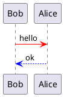

# 🚀 ATLS nRF54L15 — Release Notes & Setup Guide (Aug 21)

[](file:///c:/Users/dvthan/Projects/atls/Release/Aug21)
[](file:///c:/Users/dvthan/Projects/atls/Release/Aug21)
[](file:///c:/Users/dvthan/Projects/atls/Release/Aug21)

[](https://www.google.com/)


---

## 📋 Quick Setup Workflow
### Mermaid demo

```mermaid
graph LR
    A[1. Flash Hex] --> B[2. Open Terminal]
    B --> C[3. Check FS]
    C --> D[4. Scan & Set Wi-Fi]
    D --> E[5. Reboot]
    E --> F[6. Verify Status]
    
    style A fill:#007acc,stroke:#333,stroke-width:2px,color:#fff
    style B fill:#e67e22,stroke:#333,stroke-width:2px,color:#fff
    style C fill:#9b59b6,stroke:#333,stroke-width:2px,color:#fff
    style D fill:#2ecc71,stroke:#333,stroke-width:2px,color:#fff
    style E fill:#e74c3c,stroke:#333,stroke-width:2px,color:#fff
    style F fill:#1abc9c,stroke:#333,stroke-width:2px,color:#fff
```



### Plantuml demo


## 🧩 Code HTML chèn vào file .md để break page khi chuyển sang PDF
Nhớ add [1 empty row] ở trên và ở dưới code html

```html
<!-- add [1 empty row] -->
<div style="page-break-after: always; break-after: page;"></div>
<!-- add [1 empty row] -->
```

---

<div style="page-break-after: always; break-after: page;"></div>


## 🛠️ Step-by-Step Instructions

### 1️⃣ Flash Firmware
Flash the merged hex file to the board using <mark>**J-Flash**</mark> or <mark>**nRF Connect Programmer**</mark>:
* **Binary:** `merged_ATLS_NRF54L15_nrf54l15_cpuapp.hex`

---

### 2️⃣ Open Serial Terminal
Open the serial terminal using the **nRF Connect for VS Code** extension:
* **Baud Rate:** `115200`
* **Data Bits:** `8`, **Stop Bits:** `1`, **Parity:** `None`

---

### 3️⃣ Inspect File System
Check the active storage directory and files:

```bash
# Print current working path
fs pwd

# List files and directories
fs ls
```

---

### 4️⃣ Scan & Configure Wi-Fi

#### 📡 Scan available networks:
```bash
netcfg scan
```

#### ⚙️ Configure Wi-Fi credentials:
```bash
netcfg set ssid "your_wifi_ssid"
netcfg set password "your_wifi_password"
netcfg set security wpa2-psk
```

> [!IMPORTANT]
> **Security Type Case-Sensitivity:**
> Always use **lowercase** for the security type (e.g., `wpa2-psk`, `open`, `wpa3-sae`) as shown in the scan results.

---

### 5️⃣ Reboot System
Apply the new configuration by rebooting the device:

```bash
kernel reboot
```

---

### 6️⃣ Verify Wi-Fi Status
After the board reboots, check the connection state and assigned IP address:

```bash
netcfg status
```

> [!TIP]
> If connection fails, re-check credentials with `netcfg scan` and verify that the AP signal strength is sufficient.

---

## 📑 Command Summary Reference

| Step | Action | Shell Command | Description |
| :--- | :--- | :--- | :--- |
| **01** | `Check Path` | `fs pwd` | Display current LittleFS working directory |
| **02** | `List Files` | `fs ls` | List stored files in filesystem |
| **03** | `Scan Wi-Fi` | `netcfg scan` | Scan for nearby 2.4GHz / 5GHz Wi-Fi APs |
| **04** | `Set SSID` | `netcfg set ssid "<SSID>"` | Save Target Wi-Fi SSID |
| **05** | `Set Pass` | `netcfg set password "<PWD>"` | Save Wi-Fi Password |
| **06** | `Set Security`| `netcfg set security wpa2-psk` | Set Authentication (`wpa2-psk`) |
| **07** | `Reboot` | `kernel reboot` | Soft reset the board |
| **08** | `Check Status`| `netcfg status` | Check connection, IP, RSSI |
