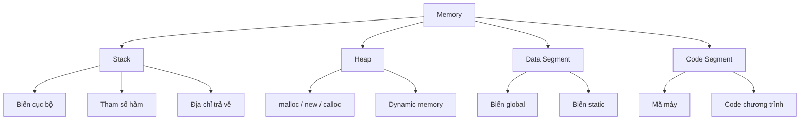

# Con Trỏ trong C: Hướng dẫn toàn diện cho người mới

Từ khái niệm cơ bản đến nâng cao — hiểu rõ bộ nhớ, pointer, và cách sử dụng hiệu quả.

---

## 1. Biến và Bộ nhớ

Trước khi học về con trỏ, bạn cần hiểu cách máy tính lưu trữ biến trong bộ nhớ. Mỗi biến bạn khai báo sẽ được cấp phát một **vị trí trong bộ nhớ** (memory address).

Ví dụ: Biến `int a = 5` không chỉ chứa giá trị **5**, mà còn có một **địa chỉ** cụ thể trong RAM (ví dụ: `0x7ffee4b8a9bc`).

### Phân vùng bộ nhớ



| Vùng nhớ | Đặc điểm | Quản lý |
| :--- | :--- | :--- |
| **Stack** | Lưu biến cục bộ, tham số hàm, địa chỉ trả về. Kích thước nhỏ (~8MB). | Tự động — giải phóng khi hàm kết thúc. |
| **Heap** | Lưu dữ liệu cấp phát động. Kích thước lớn, có thể mở rộng. | Thủ công — dùng `malloc()` và `free()`. |
| **Data Segment** | Lưu biến global, biến static. | Tự động — tồn tại suốt vòng đời chương trình. |
| **Code Segment** | Chứa mã máy (instructions) của chương trình. | Chỉ đọc, cố định. |

---

## 2. Pointer cơ bản — Con trỏ là gì?

Con trỏ (pointer) là một biến **lưu địa chỉ bộ nhớ** của một biến khác.

```c
#include <stdio.h>

int main() {
    int a = 5;        // Biến a chứa giá trị 5
    int *p = &a;      // p là con trỏ, chứa địa chỉ của a

    printf("Giá trị của a: %d\n", a);           // 5
    printf("Địa chỉ của a: %p\n", &a);          // 0x7ffee4...
    printf("Giá trị của p: %p\n", p);           // Giống &a
    printf("Giá trị tại địa chỉ p trỏ tới: %d\n", *p); // 5

    return 0;
}
```

---

## 3. Các kiểu khai báo Pointer

| Kiểu khai báo | Ý nghĩa | Ghi chú |
| :--- | :--- | :--- |
| `int* p;` | p là con trỏ đến int | Style C++, nhấn mạnh kiểu dữ liệu là "int*" |
| `int *p;` | p là con trỏ đến int | Style C truyền thống, dấu `*` gắn với biến |

> **⚠️ CẢNH BÁO:** Khi khai báo `int* p1, p2;`, chỉ `p1` là con trỏ, `p2` là biến `int` bình thường. Để khai báo cả hai là con trỏ, hãy dùng: `int *p1, *p2;`.

---

## 4. Ý nghĩa của * và &

- **Toán tử `&` (Address-of):** Lấy địa chỉ bộ nhớ của biến.
- **Toán tử `*` (Dereference):** Truy cập/sửa giá trị tại địa chỉ mà con trỏ đang trỏ tới.

```c
int a = 10;
int *p = &a;
*p = 20; // Sửa giá trị tại địa chỉ p trỏ tới (biến a đổi thành 20)
```

---

## 5. Pass by Value vs Pass by Address

### Truyền tham trị (Pass by Value)
Trong C, mặc định tham số được copy. Thay đổi bên trong hàm không ảnh hưởng biến gốc.
```c
void change(int x) { x = 10; } 
// Gọi change(a) -> a vẫn không đổi.
```

### Truyền địa chỉ (Pass by Address)
Truyền địa chỉ của biến để hàm có thể truy cập và sửa trực tiếp ô nhớ gốc.
```c
void change(int *x) { *x = 10; }
// Gọi change(&a) -> a sẽ đổi thành 10.
```

---

## 6. C++ Reference (Tham chiếu)

Trong C++ (không phải C), bạn có thể dùng `int &x` để tạo bí danh cho biến, giúp code gọn hơn pointer.

```cpp
void change(int &x) { x = 10; }
// Gọi change(a) -> a đổi thành 10.
```

---

## 7. Các loại Pointer đặc biệt

1.  **NULL Pointer:** Không trỏ đi đâu cả. An toàn để khởi tạo: `int *p = NULL;`.
2.  **Wild Pointer:** Chưa khởi tạo, chứa địa chỉ rác. **Nguy hiểm!**
3.  **Dangling Pointer:** Trỏ đến vùng nhớ đã bị giải phóng (`free`).

---

## 8. Mảng và Con trỏ

Tên mảng thực chất là một con trỏ hằng trỏ đến phần tử đầu tiên.
`arr[i]` tương đương với `*(arr + i)`.

```c
int arr[] = {10, 20, 30};
int *p = arr;
printf("%d", *(p + 1)); // In ra 20
```

---

## 9. Pointer Arithmetic (Số học con trỏ)

Khi cộng/trừ pointer, kích thước tăng/giảm phụ thuộc vào `sizeof` kiểu dữ liệu:
- `int *p`: `p + 1` tăng 4 bytes.
- `char *p`: `p + 1` tăng 1 byte.

---

## 10. malloc và free (Cấp phát động)

Dùng khi cần bộ nhớ trên **Heap** với kích thước linh hoạt.

```c
int *arr = (int*)malloc(n * sizeof(int));
if (arr != NULL) {
    // Sử dụng...
    free(arr); // Luôn giải phóng để tránh Memory Leak
    arr = NULL;
}
```

---

## 11. Struct Pointer

Sử dụng toán tử `->` để truy cập các trường của struct thông qua con trỏ.

```c
void updateGPA(Student *s, float newGPA) {
    s->gpa = newGPA; // Tương đương (*s).gpa
}
```

---

## 12. Const Pointer

| Khai báo | Ý nghĩa | Quyền hạn |
| :--- | :--- | :--- |
| `const int *p` | Pointer đến hằng | Đổi địa chỉ OK, sửa giá trị NO |
| `int * const p` | Pointer hằng | Đổi địa chỉ NO, sửa giá trị OK |
| `const int * const p` | Cả hai đều hằng | Khóa toàn bộ |

---

## 13. 10 Lỗi Pointer thường gặp

1.  **Dereference NULL:** Gây crash (Segmentation fault).
2.  **Wild Pointer:** Truy cập địa chỉ rác.
3.  **Dangling Pointer:** Sử dụng sau khi `free`.
4.  **Memory Leak:** `malloc` mà không `free`.
5.  **Return local address:** Trả về địa chỉ biến cục bộ (biến bị hủy khi hàm xong).
6.  **Sai số học con trỏ:** Nhầm lẫn giữa byte và đơn vị phần tử.
7.  **Nhầm lẫn dấu *:** Khai báo nhiều biến trên một dòng sai cách.
8.  **Quên & khi truyền:** Truyền giá trị thay vì địa chỉ vào hàm.
9.  **Array-Pointer confusion:** Cố gắng gán lại địa chỉ cho tên mảng (const).
10. **Double free:** Giải phóng một vùng nhớ hai lần.

---

## 🎯 Tổng kết

- Pointer lưu địa chỉ. `&` lấy địa chỉ, `*` lấy giá trị.
- Dùng pointer để sửa biến ngoài hàm (Pass by Address).
- Luôn khởi tạo pointer bằng `NULL`.
- Luôn `free` bộ nhớ cấp phát động.